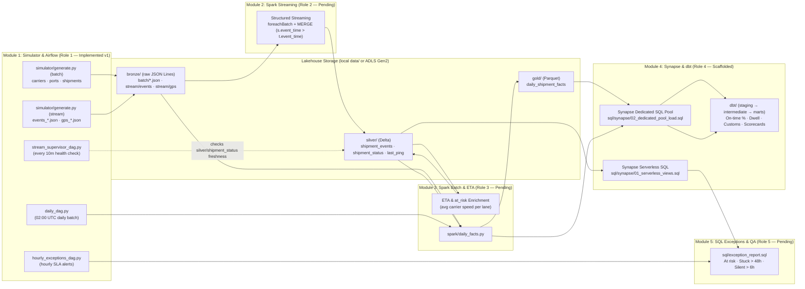
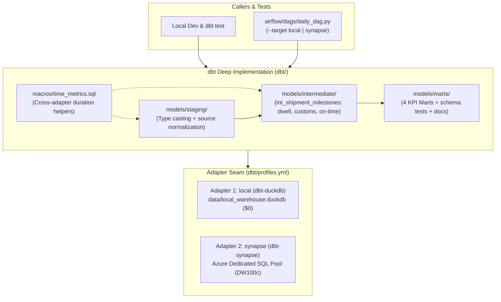

# Logistics Control Tower — System & Module Architecture

> Designed using **deep-module** principles (`codebase-design`): small, stable **interfaces** at clean **seams**, hiding complex **implementations** behind them for maximum **leverage**, **locality**, and **testability**.

---

## 1. End-to-End Lambda Architecture

The platform runs **Batch** (historical accuracy, 90-day backfill) and **Streaming** (live operational visibility) over the same Data Lakehouse (`data/` locally, **ADLS Gen2** on Azure), coordinated by **Airflow** (`airflow/dags/`).

---

## 2. System Module & Seam Map (Across the 5 Roles)

Every arrow between teams crosses a **seam** defined by a stable contract. Callers and tests cross the seam without reaching into another module's internal implementation.

| Module | Owner | Repo Location | Seam (Input Interface) | Seam (Output Interface) |
|---|---|---|---|---|
| **Simulator** | Role 1 | `simulator/generate.py` | `--mode sample \| backfill \| stream`, `--seed 42`, `--out` | `batch/{carriers,ports,shipments}.json`, `stream/events/*.json`, `stream/gps/*.json` (UTC ISO strings, atomic rename) |
| **Airflow** | Role 1 | `airflow/dags/*.py` | Volume mounts (`simulator/`, `spark/`, `dbt/`, `sql/`, `data/`), Variable `dbt_target` (`local` \| `synapse`) | Supervises stream (10m), triggers `daily_batch` (02:00), triggers `hourly_exceptions` (0 * * * *) |
| **Spark Streaming** | Role 2 | `spark/` | `stream/events/`, `stream/gps/`, dedicated `_chk/` checkpoint dir | `silver/shipment_events`, `silver/shipment_status`, `silver/last_ping` (Delta; `s.event_time > t.event_time`) |
| **Spark Batch & ETA** | Role 3 | `spark/daily_facts.py` | `batch/` master + `silver/` completed trips & GPS | Updates `ETA` / `at_risk` in status; writes `gold/daily_shipment_facts` (Parquet) |
| **Synapse + dbt** | **Role 4** | `sql/synapse/`, `dbt/` | `silver/` Delta + `gold/daily_shipment_facts` Parquet | **Live Views** (`Serverless SQL`) + **4 KPI Marts** (`Dedicated Pool` or local `DuckDB`) |
| **SQL Exceptions & QA** | Role 5 | `sql/exception_report.sql`, `docs/` | `vw_shipment_status_live` + `vw_last_ping_live` | `At risk`, `Stuck` (>48h), `Silent` (>6h) report + late-event QA suite |

### Verified Upstream Bronze Schemas (`simulator/generate.py`)
These schemas are already implemented in the repository (`STATUSES`: `picked_up -> at_port -> customs -> out_for_delivery -> delivered`, all UTC ISO):
- **`carriers.json`:** `carrier_id`, `name` (`C1` FastLine, `C2` NileCargo, `C3` DeltaFreight, `C4` SlowWave)
- **`ports.json`:** `port_id`, `name`, `country`, `lat`, `lon` (`ALX`, `DAM`, `PSD`)
- **`shipments.json`:** `shipment_id`, `origin_port_id`, `origin`, `origin_lat`, `origin_lon`, `destination`, `dest_lat`, `dest_lon`, `carrier_id`, `lane`, `pickup_time`, `promised_date`
- **`events_*.json`:** `shipment_id`, `status`, `event_time`, `ingest_time` (~5% delayed 1–48h)
- **`gps_*.json`:** `shipment_id`, `lat`, `lon`, `speed_kmh`, `ping_time`, `ingest_time` (~6% have 7–12h silent gaps)

---

## 3. Deep Architecture for Role 4 (`Synapse + dbt`)

Role 4 owns two distinct surfaces, both engineered as **deep modules** with narrow interfaces:

### A. External Seams
1. **Live Operational Seam (`sql/synapse/01_serverless_views.sql`)**
   - **Interface:** `dbo.vw_shipment_status_live` and `dbo.vw_last_ping_live`.
   - **Locality:** Role 5's `sql/exception_report.sql` queries these SQL views rather than raw `OPENROWSET` ADLS paths. Changing storage accounts, container names, or Delta paths requires editing **one view**, zero changes in downstream exception queries.
2. **Warehouse Load Seam (`sql/synapse/02_dedicated_pool_load.sql`)**
   - **Interface:** One idempotent load step called by `airflow/dags/daily_dag.py` (`load_facts_to_dedicated_pool`).
   - **Hidden Implementation:** Reads `gold/daily_shipment_facts/*.parquet` via `COPY INTO` (or staging table + `CTAS` swap), managing `DISTRIBUTION = HASH(shipment_id)` and `CLUSTERED COLUMNSTORE INDEX` internally.
3. **Analytical KPI Seam (`dbt/models/marts/`)**
   - **Interface:** Four tested, documented tables invoked by `daily_dag.py` (`dbt run` + `dbt test` with `--target {{ var.value.get("dbt_target", "local") }}`):
     - `mart_on_time_delivery` — % of delivered shipments where `delivered_at <= promised_date`.
     - `mart_port_dwell_time` — time spent at port (`at_port` -> `customs`).
     - `mart_customs_time` — time spent in customs (`customs` -> `out_for_delivery`).
     - `mart_carrier_scorecards` — monthly carrier KPIs grouped by `lane` and `month` (90-day backfill coverage).
   - **Leverage & Locality:** KPI definitions live once inside `dbt`, guaranteeing Operations and Management see identical numbers.

### B. The Real Adapter Seam (`local` vs `synapse`)
Because Role 4 runs both **locally ($0)** and on **Azure Synapse Dedicated SQL Pool**, `dbt/` separates the **warehouse adapter seam** from business logic:

- **Docker/Local Path Alignment:** `dbt/profiles.yml` sets `path: "{{ env_var('DUCKDB_PATH', 'data/local_warehouse.duckdb') }}"`, which resolves cleanly both from the Windows repo root (`./data/local_warehouse.duckdb`) and inside Airflow's Docker container (`/opt/airflow/data/local_warehouse.duckdb`, mounted in `airflow/docker-compose.yaml`).
- **Dialect Isolation:** Cross-database helpers in `dbt/macros/time_metrics.sql` (`hours_between`) and `models/staging/` absorb DuckDB vs T-SQL differences so `intermediate/` and `marts/` stay clean, portable SQL.

---

## 4. Remaining Day 2 Contract Decisions (Needed from Roles 2, 3 & 5)

Role 1's Bronze schemas are already clear in `simulator/generate.py`. Before writing the final `staging/` and `marts/` SQL, confirm with Roles 2, 3, and 5:

1. **ADLS Container & Folder Paths:** Confirm `silver/shipment_status`, `silver/last_ping`, and `gold/daily_shipment_facts` match the local `data/` layout (`data/silver/...`, `data/gold/...`).
2. **Grain & Columns of `gold/daily_shipment_facts` (from Role 3):** Confirm whether each row is 1 row per `shipment_id` (with milestone timestamps: `picked_up_at`, `at_port_at`, `customs_at`, `out_for_delivery_at`, `delivered_at`, `promised_date`) or daily snapshots `(shipment_id, fact_date)`.
3. **File Format of `gold/daily_shipment_facts`:** Confirm Role 3 outputs standard **Parquet** so Synapse Dedicated Pool can load it directly with `COPY INTO` (and DuckDB can read it locally with `read_parquet`).
4. **Master Dimension Source for `dbt`:** Confirm whether `carriers` and `ports` are already joined into `daily_shipment_facts` or loaded as separate batch tables into Dedicated Pool.
